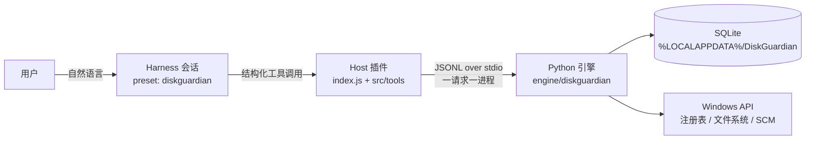

# DiskGuardian

**给 Windows 做体检，也给每一次改动留后路。**

DiskGuardian 是运行在 **DeepSeek Harness** 中的 Windows 系统维护 Agent。
你用自然语言提出需求，它负责检查、解释并——在你明确确认后——执行维护：磁盘占用、垃圾文件、
已安装软件、启动项、浏览器扩展与安全状态。

它不是"让模型直接删文件"的封装。模型只决定**查什么、怎么解释、建议怎么做**；能不能执行由独立的
Python 引擎判定，是否执行由你在确认卡片上决定。


> 当前版本 **0.9.1**，在 Windows 11 23H2（22631）上实测。Windows 10 未实测，见[已知限制](#已知限制)。

---

## 为什么需要它

大模型能读懂磁盘报告，但不该拥有无约束的删除权限。DiskGuardian 把职责拆成三层：

| 层 | 负责 | 不负责 |
|---|---|---|
| **模型** | 理解需求、选择工具、解释证据、提出建议 | 判定权限、伪造批准、执行命令 |
| **引擎** | 路径裁决、L0–L4 分级、计划、一次性授权、隔离、验证、审计 | 猜测用户意图 |
| **用户** | 在确认卡片上做最终决定 | 记住每个文件路径 |

由此得到几条硬约束：

- 没有任意命令工具，没有 PowerShell 透传，没有提权。
- 执行类工具**在自己的调用内部**弹出确认，模型无法代替用户点击。
- 批准一次性、绑定计划哈希与目标清单哈希，执行前重新核对文件状态。
- 清理一律"先隔离"；失败、截断、不可用都会如实出现在 `coverage` / `errors` / `failed_items`。

## 能做什么

- **磁盘分析**：卷容量、目录体积排行、大文件定位，按体积给出可解释的结论。
- **垃圾清理**：从临时目录与浏览器缓存中发现候选 → 分类 → 计划 → 预览 → 确认 → 隔离 → 验证 → 审计。
- **软件审计**：已安装软件清单、发布者与签名证据、安装位置与卸载方式；只给证据，不给"病毒"判决。
- **启动项**：注册表 Run / 启动文件夹条目检查；可逆地禁用与恢复，原值先入库。
- **浏览器检查**：Chrome / Edge 扩展权限、主页、启动页、默认搜索；**不读取**密码、Cookie、历史。
- **安全态势**：Defender、防火墙、安全服务、系统版本与生命周期；区分"未开启"与"查不到"。
- **可追溯**：计划、批准、隔离、恢复、清空隔离区都有审计记录，可回看实际发生了什么。

## 架构



关键设计：

- **权限在引擎里**。插件只做参数形状、超时、结果投影；模型侧拿不到数据库句柄，也没有批准入口。
- **一次调用一个短生命周期进程**。没有跨调用状态，超时即终止，启动成本约 60–100 ms。
- **SQLite 由引擎持有**。授权消费与执行落在同一事务域，批准无法被重放。
- **能力检测优先于版本号**。卷类型、`sc.exe`、注册表可读性均按实际能力判断，缺失时降级并标注覆盖率。
- **分析器不碰磁盘**。输入是扫描结果，因此可以做确定性的单元测试。

## 权限模型

| 级别 | 含义 | 实现 |
|---|---|---|
| **L0** | 只读检查 | 扫描器与分析器；无需确认 |
| **L1** | 严格规则下的临时/缓存清理 | 规则全部满足才 eligible；本版仍要求一次确认 |
| **L2** | 中风险（回收站等） | 仅识别，不进入计划，提示用户用 Windows 自行处理 |
| **L3** | 高风险（卸载、启动项） | 逐项确认 + 一次性批准；系统服务不提供工具 |
| **L4** | 禁止 | 个人文档、Windows / Program Files、未知路径、网络路径、重解析点、系统启动项 |

授权不变量：计划创建无副作用；批准只能来自真实用户确认；批准绑定 `plan_hash` + 目标清单哈希 +
15 分钟 TTL 且一次性；执行前重新验证计划、目标元数据与批准状态；消费批准后才执行，执行失败不退回批准。

## 工具一览（28）

| 类别 | 工具 |
|---|---|
| 磁盘 | `scan_disk` `scan_directories` `find_large_files` |
| 资产清单 | `list_installed_software` `inspect_startup_entries` `inspect_services` |
| 清理发现 | `list_cleanup_candidates` `classify_files` |
| 浏览器 | `inspect_browser_extensions` `inspect_browser_settings` `analyze_browser` |
| 安全 | `inspect_security_status` `analyze_security_status` |
| 分析 | `analyze_software` `analyze_startup` |
| 计划 | `create_cleanup_plan` `create_removal_plan` `preview_action_plan` |
| 执行 | `execute_cleanup_plan` `execute_removal_plan` `manage_startup_entry` `restore_quarantined_item` |
| 隔离区 | `list_quarantine` `purge_quarantine` |
| 卸载后 | `inspect_removal_residue` |
| 审计与状态 | `get_audit_log` `list_startup_changes` `engine_status` |

底层引擎共 **30 个 operation**（含 3 个内部 operation：`create_startup_plan`、`issue_approval`、
`execute_startup_plan`）。协议、参数边界与错误码见 [docs/API.md](docs/API.md)。

## 快速开始

### 前置条件

- Windows 10 / 11（Win11 23H2 实测）。
- 已安装 **DeepSeek Harness**（Desktop 版；0.2.2-rc.1 实测）。
- **Python 3.10+** 在 `PATH` 中。引擎只用标准库，无需 `pip install`；实测 CPython 3.13.2。
- 只读检查与当前用户范围内的清理**不需要管理员权限**；需要提权的操作会返回 `E_ELEVATION_REQUIRED`，不会自动 UAC。
- Node.js 仅用于开发与测试；运行时由 Harness 提供。

### 安装

```powershell
git clone https://github.com/Viver12138/DiskGuardian.git
```

在 Harness 会话中把该目录作为 bundle 安装：

```text
plugin_manager install_bundle  target = <DiskGuardian 目录的绝对路径>
```

安装完成后重启 DSH，新建任务时选择 **DiskGuardian** 预设，先运行 `engine_status` 确认引擎可用。

如果 Python 不在 `PATH`，可在启动 DSH 前指定：

```powershell
$env:DISKGUARDIAN_PYTHON = "C:\Python313\python.exe"
```

### 卸载

```text
plugin_manager remove_bundle  target = @local/dsh-diskguardian
```

卸载不会删除本地数据：

- 数据库：`%LOCALAPPDATA%\DiskGuardian\diskguardian.db`
- 隔离区：`%LOCALAPPDATA%\DiskGuardian\quarantine\`

删除前请确认隔离区里没有需要恢复的文件。

## 典型用法

| 你说 | 它做什么 |
|---|---|
| 「C 盘怎么又满了？」 | `scan_disk` → `scan_directories` → 按体积排序解释占用来源 |
| 「帮我清一下临时文件」 | `list_cleanup_candidates` → `classify_files` → 计划 → 预览 → 确认 → 隔离 → 验证 |
| 「我装了哪些可疑软件？」 | 软件清单 + 签名/发布者/安装位置证据；结论上限是 `suspicious` |
| 「开机启动项里有什么不对劲？」 | 结构信号分析 → 逐项确认 → 可逆禁用，原值入库 |
| 「浏览器里有没有乱七八糟的扩展？」 | 扩展权限 + 主页/搜索设置检查；**不读取**密码与历史 |
| 「确认不需要恢复，把隔离区清掉」 | `purge_quarantine` dry-run → 确认 → SHA-256 校验后永久删除 |

## 安全边界（务必阅读）

- **不是杀毒软件**。没有威胁情报源，不判定恶意软件，不隔离威胁，不替代 Defender。
- 不读取浏览器密码、Cookie、浏览历史、自动填充与登录凭据；数据库中没有对应表。
- 回收站只识别、不代清；浏览器扩展不由 DiskGuardian 移除（请用浏览器自身管理）。
- 清理 = 移入隔离区。隔离区与源文件同卷，**清理本身不释放空间**，只有显式 `purge` 后才释放。
- 卸载不可回滚；清理与启动项变更可恢复。
- 安装本 bundle 等于信任其源码在 Host 进程内运行；安装前请审查代码。

完整威胁模型与残余风险见 [docs/SECURITY.md](docs/SECURITY.md)。

## 数据与隐私

- 引擎**不发起任何网络请求**。
- 只保存扫描摘要、计划、批准、审计、隔离记录与启动项原始值。
- 数据仅存放在当前用户的 `%LOCALAPPDATA%\DiskGuardian\`，不承诺跨用户或跨机器恢复。
- 隔离区默认上限 5 GiB、保留 30 天；过期项不会自动删除，由你决定何时清空。

## 项目结构

```text
DiskGuardian/
├─ index.js                  # Host 插件入口：系统提示、engine_status、注册工具
├─ cordis.patch.yml          # bundle patch：声明 diskguardian 预设
├─ preset/system-prompt.md   # 预设系统提示
├─ src/
│  ├─ engine/client.js       # 子进程传输、超时终止、错误码映射
│  └─ tools/                 # 28 个工具定义与工具内确认 UI
├─ engine/
│  ├─ run.py                 # python -I run.py
│  └─ diskguardian/
│     ├─ protocol.py         # JSONL 信封、大小上限、参数边界
│     ├─ main.py             # operation 分发表
│     ├─ permissions/        # 路径校验与 L0–L4 规则
│     ├─ scanner/            # 只读采集器
│     ├─ analyzers/          # 证据型分析器
│     ├─ actions/            # 计划、批准、隔离、卸载、启动项
│     └─ storage/            # SQLite schema、迁移、审计
├─ tests/                    # Node 契约与确认链路测试
├─ tools/acceptance.py       # 沙箱内端到端验收
└─ docs/                     # 架构、安全、API、兼容性与测试报告
```

## 测试与验收

| 套件 | 数量 | 结果 |
|---|---|---|
| `python -m unittest discover -s engine/tests -t engine -v` | 96 | ✅ 全部通过 |
| `node tests/plugin.test.mjs` | 6 | ✅ |
| `node tests/tools.test.mjs` | 13 | ✅ |
| `node tests/engine-client.test.mjs` | 9 | ✅ |
| `python tools/acceptance.py` | 33 | ✅ 33/33 |

共 **157 项检查**。验收脚本在 `.tmp-tests/` 沙箱内重定向 `TEMP` / `LOCALAPPDATA` / `USERPROFILE`，
使用真实引擎与真实 JSONL 协议，不会触碰用户文件或数据库。

P0 实机检查（真实 HKCU 卸载项、真实锁文件、真实隔离区；会写 HKCU 测试项，需 `--yes`）：

```powershell
python tools/p0_real_machine.py --yes --keep
```

结果与未闭环项见 [docs/P0_REAL_MACHINE_REPORT.md](docs/P0_REAL_MACHINE_REPORT.md)。

```powershell
python -m unittest discover -s engine/tests -t engine -v
node tests/plugin.test.mjs
node tests/tools.test.mjs
node tests/engine-client.test.mjs
python tools/acceptance.py
```

## 已知限制

- **Windows 10 未实测**；代码按能力检测而非版本号分支。
- **真实第三方软件卸载未在本机执行**：P0 用受控测试卸载器验证了真实进程、注册表与验证链路；
  第三方卸载器的 GUI/UAC/延迟退出仍需在 VM 用可弃用软件验证。
- **MSI `MsiExec.exe /I{GUID}` 形式的卸载项会被拒绝**（P0 发现）：引擎目前只接受 `/X` 或
  `/uninstall`；真实 MSI 手动 `/X /qn` 可以卸载。修或不修见 [P0 报告](docs/P0_REAL_MACHINE_REPORT.md)。
- **确认卡片的真实 UI 尚未点验**：无确认服务时已用测试证明 fail-closed（不签发批准、不执行）；
  批准/拒绝/超时仍建议在 DiskGuardian 预设会话里手工走一次。
- **浏览器扩展与设置变更未实现**（刻意）：改写 `Preferences` 风险高，请用浏览器自身管理。
- Defender、计划任务等查询依赖运行时权限；沙箱内会被拒并如实降级为 `unknown` / `partial`。
- 无威胁情报源，风险结论上限为 `suspicious`，不会输出恶意软件判定。
- 一次性批准消费即失效：执行中途失败不会自动退回，需要重新确认。

## 文档

| 文档 | 内容 |
|---|---|
| [docs/ARCHITECTURE.md](docs/ARCHITECTURE.md) | 分层、数据流、关键决策 |
| [docs/SECURITY.md](docs/SECURITY.md) | 威胁模型、权限、授权不变量、残余风险 |
| [docs/API.md](docs/API.md) | 引擎 operation、参数边界、错误码 |
| [docs/COMPATIBILITY.md](docs/COMPATIBILITY.md) | 支持矩阵与环境限制 |
| [docs/ENVIRONMENT_REPORT.md](docs/ENVIRONMENT_REPORT.md) | 运行时与 Harness API 实测 |
| [docs/TEST_REPORT.md](docs/TEST_REPORT.md) | 测试覆盖与未验证清单 |
| [docs/INSTALLATION_REPORT.md](docs/INSTALLATION_REPORT.md) | 安装状态与验收表 |
| [docs/ACCEPTANCE.md](docs/ACCEPTANCE.md) | 端到端验收场景 |
| [docs/P0_REAL_MACHINE_REPORT.md](docs/P0_REAL_MACHINE_REPORT.md) | P0 实机：卸载、启动项、锁文件、隔离区异常 |

## 许可证

尚未指定开源许可证；在添加 `LICENSE` 之前，默认保留所有权利。若希望以开源方式分发，
建议先由作者选定许可证（例如 MIT）再发布。

---

## English overview

DiskGuardian is a Windows maintenance agent for **DeepSeek Harness**. It inspects disk usage,
temporary/cache files, installed software, startup entries, browser extensions, and security
posture through natural language — and performs changes only after an explicit in-tool
confirmation by the user.

The model decides *what to inspect and recommend*. A separate Python engine decides *what is
allowed*: path rules, L0–L4 risk classes, durable plans, one-time approvals bound to plan and
target hashes, quarantine-first cleanup, verification, and audit logging. There is no arbitrary
command tool, no PowerShell passthrough, and no self-elevation.

- **28 structured tools**, **30 engine operations**, **157 passing checks** (v0.9.1).
- Cleanup is reversible: files move to a quarantine, and only an explicit `purge_quarantine`
  deletes them permanently after hash verification.
- Read-only inspection needs no administrator rights; operations that require elevation fail
  with `E_ELEVATION_REQUIRED` instead of prompting for UAC.
- Not an antivirus: it reports evidence, never a malware verdict.

Clone the repository, install the directory as a bundle with `plugin_manager install_bundle`,
restart DSH, and select the **DiskGuardian** preset. Python 3.10+ (standard library only) is
required. See [docs/SECURITY.md](docs/SECURITY.md) before trusting it with real cleanup.
